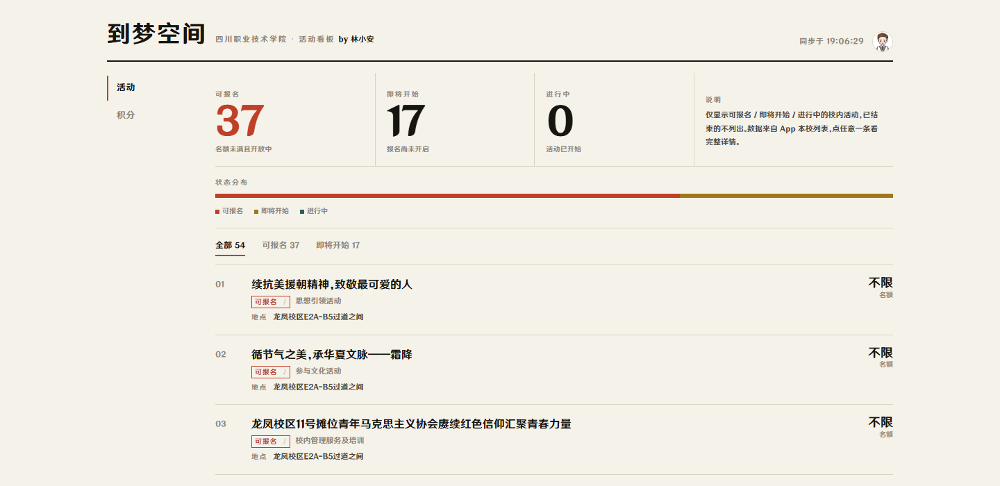
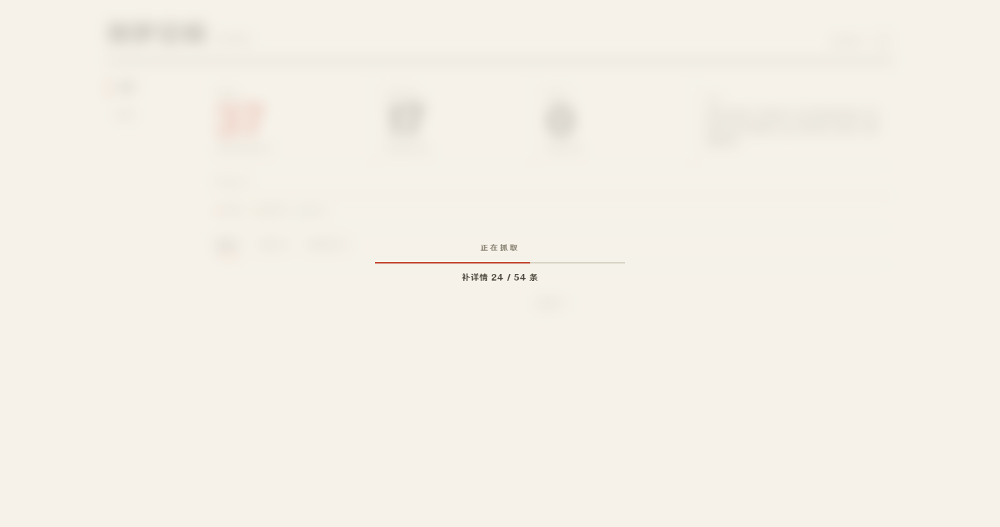

# 到梦空间 · 活动看板

把「到梦空间」App 里那堆要一层层点进去才看得到的校内活动，摊成一张随时能刷的网页：**哪些在报名、还剩多少名额、在哪栋楼、什么时候截止**，一眼扫完。



**在线实例**：<http://139.155.153.95:8770/?k=FuXiaoSheng>（打开后用自己的到梦空间账号登录）

---

## 它能做什么

- **多人各自登录**：打开网页用自己的到梦空间账号登录，首次登录自动注册；每人一个独立数据库（`data/users/<uid>.db`），互不影响
- **实时汇总**：一键拉取本校活动列表（约 400 条，10 页并发），按「可报名 / 即将开始 / 进行中」分组
- **名额与地点**：列表接口没有的字段（剩余名额、活动地点、起止时间）逐条补详情，落 SQLite 缓存，同校的人共享
- **点开即看**：右侧抽屉直接展示报名时间、活动时间、地点、主办、类别、级别、报名制说明
- **我的积分**：左侧「积分」页读取 App「我的」页的真实积分（`/v3/user/mine_homepage`）
- **抓取进度**：抓取时全屏羽化模糊，正中一条进度条，先「抓取 x/10 页」再「补详情 y/z 条」
- **手机可看**：响应式布局，窄屏自动折成两列统计 + 单列列表
- **不用装 App、不用保持手机在线**：账号密码直登；token 失效时看板会提示，点「重新登录」回登录页重输密码

---

## 界面

| 区域 | 说明 |
|---|---|
| 顶栏 | 标题 / 学校 / 上次同步时间 / 头像菜单（刷新活动、退出登录） |
| 左侧导航 | 活动 · 积分，两个视图切换（窄屏折成顶部标签） |
| 统计行 | 可报名、即将开始、进行中（已结束的不进列表） |
| 状态分布条 | 三种状态按比例绘制的一条细线 |
| 列表 | 序号 · 标题 · 状态标签 · 类别 / 主办 / 地点 · 剩余名额 |
| 抽屉 | 点任意一条，右侧滑出完整详情 |
| 积分页 | 姓名 · 学院、到梦空间积分、数据来源与读取时间 |
| 抓取遮罩 | 抓取中全屏模糊，正中显示进度 |



视觉上刻意去掉了「后台管理系统」那套深色卡片 + 荧光绿，改成纸色底 + 宋体标题 + 单色强调，像一张印刷的活动通告。

---

## 快速开始

### 方式一：云服务器（推荐，一次装好长期跑）

```bash
# 1. 上传并解包（包里只有运行必需文件，约 50 KB）
scp dream-monitor-slim.zip root@你的IP:/root/
cd /root && apt-get install -y unzip
unzip -o dream-monitor-slim.zip -d /root/dream-monitor

# 2. 一键安装（装依赖 + 注册 systemd 服务 + 开机自启）
cd /root/dream-monitor
sudo bash deploy/install.sh
```

`install.sh` 会自己处理 Python 版本差异：先试 `apt install python3-yaml`（免编译，Ubuntu 26.04 / Python 3.14 也能过），失败再退到 venv，最后才 `--break-system-packages`。

装完浏览器打开 `http://你的IP:8770/?k=你的口令` 即可。**首次打开约 3 秒**——10 页列表并发拉取 + 详情并发补全，同校第二个用户命中共享缓存后更快。

### 方式二：本地跑

```bash
pip install pyyaml
cp config.example.yaml config.yaml   # 然后填 api.account / api.password
python gui_server.py --code 你的口令
```

Windows 上如果 `pip` 装包被拦，可直接用系统 Python 跑，本项目除 PyYAML 外**全部标准库**。

---

## 工作方式

```
┌──────────────┐   AES-CBC + RSA 封装   ┌────────────────┐
│  gui_server  │ ─────────────────────► │ appdmkj.5idream│
│  (HTTP 8770) │ ◄───────────────────── │     .net       │
└──────┬───────┘      fastjson + 签名    └────────────────┘
       │
       │ 每 180s 一轮
       ▼
┌──────────────┐   ┌──────────────┐   ┌──────────────┐
│   monitor    │──►│    store     │──►│   ui/index   │
│ 拉取/比对/补详情│   │  SQLite 去重 │   │   单页看板    │
└──────────────┘   └──────────────┘   └──────────────┘
```

- `dmcrypto.py` — AES-128-CBC、RSA PKCS#1 v1.5、base64 每 60 字符插空格、fastjson 紧凑序列化、`signToken` 双层哈希
- `dm_des.py` — 纯 Python 实现的 DES（密码字段用）
- `dmclient.py` — 请求封装、限速、错误码映射、自动重登
- `monitor.py` — 翻页抓取、详情补全、状态 diff、事件生成
- `store.py` / `rules.py` — SQLite 持久化与字段归一化
- `gui_server.py` — 标准库 `ThreadingHTTPServer` + JSON API + 口令校验
- `ui/` — 无框架单页，CSS 变量做设计令牌，动效只用 transform / opacity

---

## 协议备忘（逆向笔记）

> 以下内容来自对客户端行为的实测对齐，仅作协议研究记录。

**传输层**：`POST https://appdmkj.5idream.net`，请求头带设备指纹 `standardUA` 与 `user-agent: okhttp/3.11.0`，表单字段 `d=<密文>`。

**密文构造**：

```
d = b64_spaces( AES-CBC( fastjson(参数表), key=随机16位, iv=ReIV ) + "==" + b64( RSA( key ) ) )
```

- 每次请求随机生成 16 位 `[A-Za-z0-9]` 作为 AES 密钥，用服务端公钥 RSA 加密后拼在末尾
- `base64` 每 60 字符插一个空格，是客户端自己的混淆
- 参数表用 fastjson 紧凑格式（键排序、无空格、非 ASCII 原样），签名基于**不含 `signToken` 的明文表**计算，`signToken = MD5( SHA512(json)[1::2][0::2] ).upper()`

**登录**：`pwd` 字段是 `DES-ECB(key=51434574, PKCS5, 明文密码)` 的 32 位大写十六进制；参数表必须带空的 `uid` / `token` 两个键，且**不能带 `timestamp`**，否则一律 `11002 参数错误`。

**错误码**：`100` 成功 / `10005`·`10007` 登录失效 / `11001` 签名错误 / `11002` 参数错误 / `1200` 手机号不存在 / `90000022` 密码错误（会扣剩余次数，`11002` 不扣）。

---

## 命令一览

```bash
python cli.py login                 # 用 config.yaml 里的账号密码登录，写回 token
python cli.py probe                 # 探测接口 + 打印字段结构（校准字段名用）
python cli.py once                  # 抓一轮，打印统计
python cli.py run                   # 常驻轮询
python gui_server.py --code 口令    # 起网页看板（默认 0.0.0.0:8770）
python share.py <分享码>            # 免登录查单个活动的分享页数据
python watch.py add <分享码>        # 监控指定活动，名额释放时提醒
```

`tools/` 下的脚本是逆向期的取证工具（内存扫描、frida hook、token 同步），**不进仓库**。

---

## 常见问题

**Q：为什么第一次打开是空的？**
A：全新数据库首次约 3 秒（本地实测 2.8~2.9 秒）。`journalctl -u dream-monitor -f` 会看到 `抓取 400 条｜...`。

**Q：token 会过期吗？**
A：没有固定有效期，但**手机 App 退出登录或重新登录会让旧 token 立刻作废**。本项目检测到 `10007` 时不会偷偷帮你重登（那会把手机挤下线），而是在看板顶部提示，点「重新登录」跳到登录页、账号已填好，你只需再输一次密码。

**Q：能不能多台机器同时跑？**
A：不建议。每次账号登录都会作废上一个 token，两个实例会互相挤、反复重登。

**Q：端口改了怎么生效？**
A：`DM_PORT=9000 sudo bash deploy/install.sh`，或改 `/etc/systemd/system/dream-monitor.service` 里的 `Environment=DM_PORT=`。

---

## 已知边界

- 只覆盖**本校**活动列表；全国活动（`/public/activity/list`，仅 35 条）未接入
- 首次全量抓取约 3 秒；此后每轮命中本地缓存，约 2.5 秒
- 地点字段来自详情接口，主办方没填就是空的
- 自动报名功能存在但默认关闭，且未做风控，不建议打开

## 版本历史

- 当前版本见仓库根目录的 [`VERSION`](VERSION)
- 完整变更记录见 [`CHANGELOG.md`](CHANGELOG.md)

## 免责声明

个人学习用途。数据来自公开可访问的客户端接口，仓库内不包含任何账号、密码、令牌或他人隐私数据（`config.yaml` 已被 `.gitignore` 排除）。请勿用于批量刷取或商业用途。

## 许可证

[MIT](LICENSE) © 2026 LinXiaoAn
